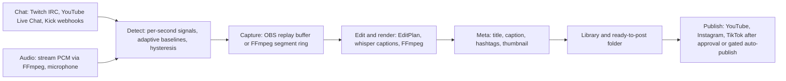
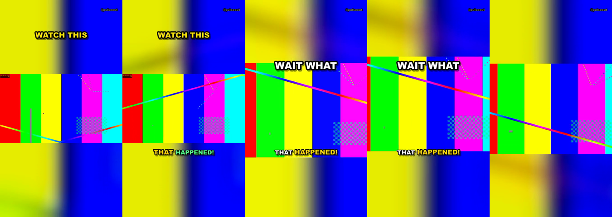

# PulseCut

Local-first livestream clipping in Rust: detect highlight moments, capture the footage, render a vertical short, and queue it for review.

[](https://github.com/SJ-Hariharan/PulseCut/actions/workflows/ci.yml)
[](LICENSE)

## Overview

PulseCut watches a live stream through its chat and audio, scores moments that look like highlights, and captures the footage around each one. It renders the footage as a 9:16 vertical video with word-level captions, writes a title, caption, hashtags and thumbnail, and places the result in a local library. A clip can then be approved and uploaded to a platform, or left for manual posting.

Processing runs on your machine. PulseCut has no telemetry backend. Speech-to-text uses a local whisper.cpp model, and the optional metadata LLM is a local endpoint you configure.

The current release is `0.1.0`. It has been verified on macOS (Apple Silicon) only. See [Project status and limitations](#project-status-and-limitations).

## Features

### Verified on macOS (Apple Silicon)

- **OBS Studio integration.** Connects to OBS Studio 33 over obs-websocket 5.x with a password stored in the keychain. Clips are taken from the OBS replay buffer with a deferred save, so the post-roll is included.
- **Vertical rendering.** Renders 1080x1920 vertical clips with animated captions, a thumbnail, an SRT file and a JSON decision trail.
- **YouTube upload.** Uploads through the YouTube Data API using OAuth (loopback redirect with PKCE, `youtube.upload` scope). The default privacy setting is `unlisted`.
- **Multi-channel Twitch watching.** Each channel in Settings > Platforms > Twitch channels is watched for chat. Each one also becomes a candidate video source, `twitch:<channel>`, that is resolved to an HLS URL with yt-dlp. See [Using PulseCut as a Twitch clipper](#using-pulsecut-as-a-twitch-clipper).
- **Ready-to-post folders.** For each rendered clip, PulseCut writes `ready-to-post/<clip>/` in the library with `video.mp4`, `thumbnail.jpg`, `post.txt` and `post.json`.

### Implemented but not verified in this release

- **Auto-publish.** Off by default. When enabled, it publishes only autonomous (non-manual) clips that meet a minimum confidence, have full coverage, and are under a per-platform daily cap. See [Publishing](#publishing).
- **Windows build and packaging.** A packaging script exists (`scripts/package-windows.ps1`), but the Windows build has not been compiled or run.
- **Instagram Reels, TikTok, Kick and YouTube Live chat.** Code is present; none of these has been verified against the live service. See [Project status and limitations](#project-status-and-limitations).
- **Voice commands and microphone analysis.** Unit-tested, but the live microphone path has not been exercised.
- **Detection quality.** Measured on synthetic labelled streams only. These numbers do not show accuracy on real streams. See [docs/PERFORMANCE.md](docs/PERFORMANCE.md).

### Editing

- Output formats: 9:16, 16:9 and 1:1.
- Layouts: blurred fill, center, smart crop and facecam split.
- Word-level animated captions with a selectable style and position.
- Effects: freeze, punch-in, slow motion, replay, shake, flash and reaction text.
- Sound effects: 13 built-in CC0 sounds with ducking, and loudness normalization.
- Optional hook, watermark and outro text.

## Architecture

PulseCut is a Cargo workspace of 13 crates:

| Crate | Role |
|---|---|
| `pulsecut-core` | Domain model, settings, paths, safe process runner |
| `pulsecut-detect` | Streaming highlight detection, synthetic datasets, evaluation and weight tuning |
| `pulsecut-media` | FFmpeg orchestration: probing, render graphs, captions, whisper.cpp transcription, thumbnails, sound effects |
| `pulsecut-edit` | Editing recipes: decides layout, captions and effects per clip (no rendering) |
| `pulsecut-meta` | Titles, captions, descriptions and hashtags from templates, with an optional local LLM |
| `pulsecut-store` | SQLite persistence: clip library, durable job queue, uploads, events |
| `pulsecut-capture` | OBS controller, FFmpeg rolling segment buffer, capture coordinator |
| `pulsecut-chat` | Twitch IRC, YouTube Live Chat polling, Kick webhook verification |
| `pulsecut-publish` | OAuth (loopback + PKCE), YouTube resumable uploads, Instagram Reels, TikTok inbox upload, upload worker |
| `pulsecut-platform` | OS abstractions: microphone, keychain, global hotkeys, autostart, notifications, system stats |
| `pulsecut-engine` | Orchestrator, render pipeline, multi-stream focus, voice commands, local API, demo |
| `pulsecut-cli` | Command-line binary `pulsecut-cli` |
| `pulsecut-app` | Desktop application (egui/eframe), binary `PulseCut` |

The pipeline runs from chat and audio to publishing:



Key design points, detailed in [docs/ARCHITECTURE.md](docs/ARCHITECTURE.md):

- **Coverage is reported.** Each capture records what was requested and what was actually covered. If the moment itself is missing, the clip is marked as failed rather than silently shortened.
- **Edit decisions are separate from rendering.** The planner produces a serializable `EditPlan`, which can be inspected and edited before re-rendering.
- **Durable queue.** Render and upload work is stored in SQLite, so interrupted jobs are re-queued on restart and uploads resume from a saved session URL.

Sample render (synthetic test pattern), from [docs/research/render-sheet.png](docs/research/render-sheet.png):



## Requirements

- **Rust toolchain** with edition 2024 support. The minimum supported Rust version is 1.88 (`rust-version` in `Cargo.toml`).
- **FFmpeg and ffprobe.** PulseCut looks for them in the configured path, then on `PATH`, then in the default install locations for the platform (on macOS: `/opt/homebrew/bin` and `/usr/local/bin`).
- **Optional: whisper.cpp and a ggml model.** Provides `whisper-cli` and a model file. Without them, clips are rendered without captions. Model file names searched by default are `ggml-base.en.bin`, `ggml-small.en.bin`, `ggml-tiny.en.bin` and `ggml-base.bin`.
- **Optional: yt-dlp.** Needed to resolve `twitch:` and `youtube:` sources to playable URLs.
- **OBS Studio.** Only needed when using the OBS replay-buffer backend. Enable its WebSocket server.

## Installation

### Build from source

```bash
git clone https://github.com/SJ-Hariharan/PulseCut.git
cd PulseCut
cargo build --release -p pulsecut-app -p pulsecut-cli
```

This produces:

- `target/release/PulseCut`: the desktop application
- `target/release/pulsecut-cli`: the command-line tool

The workspace tests run with `cargo test --workspace --release`. Some tests start local mock servers on `127.0.0.1` and need permission to bind local ports.

### macOS app bundle

```bash
scripts/package-macos.sh release
```

This builds `target/dist/PulseCut.app` with an ad-hoc signature and, when `hdiutil` is available, a `.dmg`. The bundle does not use a Developer ID certificate.

### Install FFmpeg and whisper.cpp on macOS

```bash
brew install ffmpeg whisper-cpp yt-dlp
```

`yt-dlp` is only needed for `twitch:` and `youtube:` sources. To enable captions, download a model into `models/` next to the executable, or into the models folder under the app data directory:

```bash
mkdir -p models && curl -L -o models/ggml-base.en.bin https://huggingface.co/ggerganov/whisper.cpp/resolve/main/ggml-base.en.bin
```

## Quick start

### Desktop app

1. Launch `PulseCut` (from `target/dist/PulseCut.app` or `target/release/PulseCut`).
2. Open **Settings** and choose a capture backend. See [docs/USER_GUIDE.md](docs/USER_GUIDE.md) for the OBS setup steps.
3. Use **Clip now** on the Dashboard, or the default hotkey `CmdOrCtrl+Shift+K`, to create a clip.
4. Review clips in **Clip Library**. Each clip has a `ready-to-post` folder in the library.

### Demo without accounts

```bash
./target/release/pulsecut-cli demo
```

The demo generates a synthetic stream and a synthetic chat audience. It runs detection, captures the moment, renders a clip, writes captions, a title and a thumbnail, and adds it to the library. Output goes to `./demo-output`, and the run report is written to `demo-output/demo-report.json`. Use `--out <dir>` to choose a different folder.

## Configuration

### Settings file

Settings are stored in `settings.toml` in the app config directory. On macOS this is the `app.PulseCut.PulseCut` folder under `~/Library/Application Support/`. Run `pulsecut-cli settings` to print the effective path and contents.

Partial files are allowed. Missing keys use defaults, and out-of-range values are clamped. A few keys that are often changed:

```toml
[capture]
backend = "obs_replay_buffer"   # or "segment_buffer"
pre_roll_secs = 20.0
post_roll_secs = 10.0
max_parallel_buffers = 2        # hottest extra streams to buffer, 0 to disable

[detection]
autonomous_enabled = true
sensitivity = 0.5               # 0 = only huge moments, 1 = clip a lot
chat_reaction_delay_secs = 6.0

[publish]
auto_publish = false            # off by default
youtube_privacy = "unlisted"

[resources]
local_api_port = 47120          # 127.0.0.1 only; 0 disables the local API
```

With the defaults, OBS needs a replay buffer of at least 42 seconds (`pre_roll + post_roll + save_margin + chat_reaction_delay + 4`). PulseCut warns in the UI if the buffer is shorter.

### Secrets

Secrets are never written to `settings.toml` or the SQLite database. They are stored in the OS keychain (macOS Keychain, or Windows Credential Manager), under the service name `app.pulsecut.PulseCut`. The entry names are:

| Entry | Used for |
|---|---|
| `obs-websocket` | OBS WebSocket password |
| `youtube-api-key` | YouTube Live chat (Data API key) |
| `youtube-oauth` | YouTube OAuth tokens (written after sign-in) |
| `youtube-client-secret` | Google OAuth client secret |
| `instagram-token` | Instagram Graph API token |
| `tiktok-oauth` | TikTok OAuth tokens (written after sign-in) |
| `tiktok-client-secret` | TikTok client secret |
| `kick-public-key` | Kick webhook signature verification (PEM) |

Store a secret from a terminal with `pulsecut-cli set-secret <name>`, which reads the value from stdin. The desktop app's Settings page also has a field for each secret.

### Paths and environment variables

- **`PULSECUT_HOME`** overrides the platform directories. It also works as the `--home <dir>` global option of `pulsecut-cli`. Under this root, PulseCut uses:
  - `config/settings.toml`
  - `data/library/` (clips, covers, thumbnails, SRT, JSON; the default library location)
  - `data/pulsecut.sqlite`
  - `data/raw/` (raw captures)
  - `cache/segments/` (rolling segment buffers)
- **`PULSECUT_KEEP_RENDER`** is read only by a real-render integration test in `pulsecut-media`. When set to a directory, the test copies its output there for inspection. It has no effect on the app or CLI.

Library location and retention are set in Settings > Storage, or with `[storage]` in `settings.toml`. The low-disk guard (`min_free_gb`) pauses capture when free space drops below the threshold.

## Using PulseCut as a Twitch clipper

1. In **Settings > Platforms > Twitch channels**, add the channels to watch. No Twitch login is needed. Chat is read anonymously over IRC.
2. Each channel also becomes a source with the id `twitch:<channel>`. PulseCut resolves it to an HLS URL with yt-dlp, at the best quality up to 1080p. The URL is resolved again on every restart of the buffer. While a channel is offline, the lookup is retried every 30 seconds. The first channel is the home channel: if OBS is enabled (or a rolling-buffer `segment_source` is set) it keeps that capture instead. For a pure clipper setup, turn OBS off in Settings so every listed channel is recorded from Twitch.
3. The capture buffer is limited by `max_parallel_buffers` (default 2, range 0 to 8). PulseCut ranks the watched channels by hype index, buffers the hottest ones, and switches focus only after a dwell period, so buffers do not flap between channels.
4. An explicit `[[capture.extra_sources]]` entry with the same `stream_id` replaces the automatic source for that channel.
5. When a clip is rendered, its `ready-to-post/<clip>/` folder contains:
   - `video.mp4`: the vertical clip (hard-linked from the library when possible)
   - `thumbnail.jpg`: the vertical cover
   - `post.txt`: title, caption, hashtags, description, credit line and file list
   - `post.json`: the same fields as structured data, plus `source`, `stream_id` and `duration_s`

The credit line names the channel and links to its Twitch page. Only clip and repost streams you have the rights to use, or the streamer's permission.

## Local API

When `resources.local_api_port` is not 0, the engine listens on `127.0.0.1:<port>` (default `47120`). It is not reachable from other machines. The API does not require authentication, so any local process can call it.

| Method and path | Purpose |
|---|---|
| `GET /api/status` | JSON with OBS state, the home channel, per-stream message rate, score, hype index and capture state, clip count, and whether capture is paused |
| `POST /api/clip` | Starts a manual clip, the same path as the hotkey. Returns `{"ok": true, "event_id": ...}` |
| `POST /webhooks/kick` | Receives Kick `chat.message.sent` events. Verifies the signature against `kick-public-key`. Returns 503 if no key is saved, 401 if the signature is invalid, and 204 for other event types. Requires a public HTTPS tunnel to this port |

Example:

```bash
curl -X POST http://127.0.0.1:47120/api/clip
```

## Publishing

Nothing is uploaded until a clip is approved, unless auto-publish is enabled.

- **YouTube Shorts.** Create a Google Cloud OAuth client of type *Desktop app* with the YouTube Data API v3 enabled. Enter the client ID in Settings > Platforms, store the client secret in the keychain, and choose the privacy setting (default `unlisted`). Then use **Connect** on the Publishing page. Uploads are resumable.
- **Instagram Reels (unverified).** Requires a professional account, a Graph API token, the Instagram user id, and a public HTTPS folder that PulseCut copies the clip into. Instagram downloads the file from that URL. PulseCut removes the hosted copy after publishing.
- **TikTok (experimental, unverified).** Uploads the clip to your TikTok inbox as a draft. You finish posting in the TikTok app. Requires your own TikTok developer app.
- **Auto-publish.** Off by default. When on, it publishes only autonomous clips with confidence at or above `auto_publish_min_confidence` (default 0.85), full coverage, and fewer than `auto_publish_max_per_day` uploads per platform in the last 24 hours (default 3). Manual clips are never auto-published.

Hard limits in the upload worker, applied per platform per day: YouTube 90, Instagram 45, TikTok 15.

Step-by-step setup is in [docs/USER_GUIDE.md](docs/USER_GUIDE.md#publishing).

## Project status and limitations

Version 0.1.0 is an early release.

**Verified on macOS (Apple Silicon):** OBS Studio 33 connection with a password, replay-buffer clipping, 1080x1920 vertical rendering with captions and thumbnails, YouTube upload via OAuth with unlisted default privacy, multi-channel Twitch watching, and ready-to-post folders.

**Not verified in this release:**

- **Windows.** The build and packaging are untested. The script `scripts/package-windows.ps1` and the CI job are defined but have not been run.
- **Linux.** Not a supported target.
- **Intel Macs.** No architecture-specific code, but not tested.
- **Instagram Reels.** Needs a professional account, a Graph token, and a public HTTPS media host.
- **TikTok.** Experimental. Uploads land as inbox drafts.
- **Kick.** Needs a public webhook tunnel to the local API port and the Kick public key.
- **YouTube Live chat.** Needs a YouTube Data API key. Polling is quota-aware.
- **YouTube uploads from unverified OAuth apps.** YouTube may restrict uploads from an unverified OAuth app to private visibility until Google's API audit is complete.
- **Detection accuracy on real streams.** The benchmark uses synthetic streams written by the same authors as the detector.

Test results and the list of what has not been run are in [docs/TESTING.md](docs/TESTING.md).

## Documentation

- [docs/USER_GUIDE.md](docs/USER_GUIDE.md): installation, OBS setup, autonomous mode, editing, publishing, CLI reference, troubleshooting table
- [docs/ARCHITECTURE.md](docs/ARCHITECTURE.md): data flow, capture and detection design, persistence and concurrency
- [docs/PLATFORM_SUPPORT.md](docs/PLATFORM_SUPPORT.md): per-platform status (macOS, Windows)
- [docs/PERFORMANCE.md](docs/PERFORMANCE.md): render timings, transcription, synthetic detection benchmark, resource use
- [docs/TESTING.md](docs/TESTING.md): how to run the tests, results, and what is not yet tested
- [docs/LICENSING.md](docs/LICENSING.md): licenses of PulseCut, bundled assets and external tools
- [docs/REUSE_MATRIX.md](docs/REUSE_MATRIX.md): ideas taken from other projects and how each was reimplemented
- [docs/RESEARCH.md](docs/RESEARCH.md): research notes behind the design
- [docs/setup.md](docs/setup.md): setup guide
- [docs/configuration.md](docs/configuration.md): configuration reference
- [docs/troubleshooting.md](docs/troubleshooting.md): troubleshooting

## Contributing

See [CONTRIBUTING.md](CONTRIBUTING.md). Report security issues as described in [SECURITY.md](SECURITY.md). Community standards are in [CODE_OF_CONDUCT.md](CODE_OF_CONDUCT.md).

## Responsible use

Only clip and repost streams you have the rights to use, or the streamer's permission. Respect platform terms and the creators whose streams you watch.

## License

PulseCut is licensed under the [Apache License 2.0](LICENSE). The 13 built-in sound effects are procedurally synthesized and released under [CC0-1.0](docs/LICENSING.md). See [docs/LICENSING.md](docs/LICENSING.md) for the licenses of external tools (FFmpeg, whisper.cpp, OBS Studio) and Rust dependencies.
